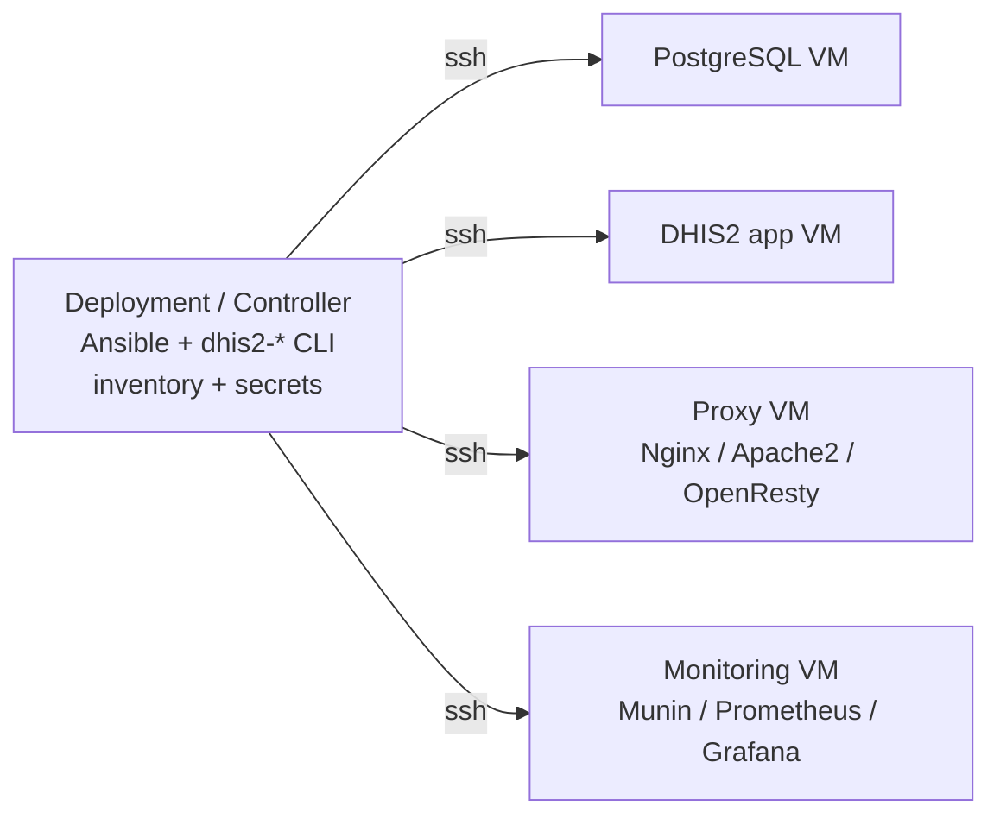

# DHIS2 Server Tools

Opinionated, Ansible-based deployment and lifecycle tooling for
[DHIS2](https://dhis2.org/). This repository ships two layers that work
together:

1. An operator-facing **`dhis2-*` command family** that standardises
   preflight, planning, lifecycle, backup, restore, upgrade,
   diagnostics, and security operations behind safety gates and
   machine-readable output.
2. The underlying **Ansible roles and playbooks** that remain the
   authoritative configuration engine — the same ones that
   `deploy/deploy.sh` has always invoked.

A finished deployment gives you one or more DHIS2 instances backed by
PostgreSQL, served by Nginx / Apache2 / OpenResty with Let's Encrypt or
custom TLS, and monitored out of the box with Glowroot APM plus
Munin or Prometheus/Grafana. Optional add-ons include Apache Doris
for analytics, WireGuard for admin access, and alerting hooks.

> **No-regression promise.** Every existing workflow still works. If
> you already run `sudo ./deploy/deploy.sh` or
> `ansible-playbook deploy/dhis2.yml --tags <tag>`, nothing changes —
> the CLI is additive. See
> [docs/Compatibility.md](./docs/Compatibility.md).

---

## Table of contents

- [Supported deployment architectures](#supported-deployment-architectures)
- [Install the CLI](#install-the-cli)
- [Operator command reference](#operator-command-reference)
- [Common workflows](#common-workflows)
  - [Day-one deployment](#day-one-deployment)
  - [Safe redeployment and `dhis.conf` preservation](#safe-redeployment-and-dhisconf-preservation)
  - [Instance lifecycle](#instance-lifecycle)
  - [Backup and restore](#backup-and-restore)
  - [Controlled DHIS2 upgrade](#controlled-dhis2-upgrade)
  - [Diagnostics and status](#diagnostics-and-status)
  - [Multi-environment control plane](#multi-environment-control-plane)
- [Direct Ansible workflows (preserved)](#direct-ansible-workflows-preserved)
  - [LXD single-host](#lxd-single-host)
  - [Distributed SSH](#distributed-ssh)
  - [Hybrid LXD + SSH](#hybrid-lxd--ssh)
- [Adding a new instance](#adding-a-new-instance)
- [Using a custom TLS certificate](#using-a-custom-tls-certificate)
- [Testing and no-regression evidence](#testing-and-no-regression-evidence)
- [Documentation index](#documentation-index)

---

## Supported deployment architectures

| Architecture | State | Description |
| ------------ | ----- | ----------- |
| **LXD single-host** | SUPPORTED | One Ubuntu host runs proxy, PostgreSQL, DHIS2, and monitoring as LXD containers. |
| **Distributed SSH** | SUPPORTED | Separate physical / virtual servers for proxy, PostgreSQL, DHIS2 app, and monitoring. The controller orchestrates them over SSH. |
| **Hybrid LXD + SSH** | SUPPORTED | Any mix of LXD-managed and SSH-managed hosts; `ansible_connection` is resolved per host. |
| **Docker** | NOT IMPLEMENTED | Explicitly not supported until implemented and tested. |
| **Kubernetes** | NOT IMPLEMENTED | Explicitly not supported until implemented and tested. |

`dhis2-deploy architectures` prints this matrix at runtime.
Full architecture discussion:
[docs/Deployment-Architectures.md](./docs/Deployment-Architectures.md).

**Host requirements for every architecture:**

- Ubuntu 22.04 or 24.04 on the controller and on every managed host.
- Minimum 4 GB RAM / 2 CPU for a single-host LXD deployment; size up for
  production workloads.
- SSH access from the controller to each managed host, with sudo (or
  the ability to prompt for become-pass).
- `ufw` installed; `deploy.sh` and the CLI refuse to proceed with the
  firewall disabled.

---

## Install the CLI

The CLI is a thin orchestration layer that calls the existing Ansible
roles. Installing it does **not** change any role behaviour.

```bash
git clone https://github.com/vitalworks-limited/dhis2-server-tools.git
cd dhis2-server-tools
sudo ./install.sh
dhis2-deploy --version
```

The installer lays the toolset under `/opt/dhis2-server-tools` and
creates symlinks in `/usr/local/bin`. State, locks, history, and
snapshots live under `/var/lib/dhis2-server-tools`; audit logs under
`/var/log/dhis2-server-tools`. Uninstall with `sudo ./install.sh
--uninstall` (data directories are preserved).

**Common options supported by every command where applicable:**

```
--inventory PATH         Explicit inventory path
--environment NAME       Named environment (/etc/dhis2-server-tools/environments/NAME)
--limit HOST_OR_GROUP    Ansible --limit
--instance NAME          Scope operation to a single DHIS2 instance
--host NAME              Scope operation to a host
--user USER              Remote SSH user
--connection lxd|ssh     Override connection selection
--check                  Non-destructive planning (--check mode)
--diff                   Show diffs
--verbose / --quiet
--yes                    Non-interactive confirmation
--json                   Machine-readable output (human logs on stderr)
--no-color
--help / --version
```

**Exit codes:** `0` success, `1` generic failure, `2` invalid
arguments, `3` preflight failed, `4` connectivity, `5` Ansible
execution, `6` health check, `7` partial success — review required,
`8` safety check prevented destructive action, `9` concurrent-operation
lock conflict.

---

## Operator command reference

| Command | Purpose |
| ------- | ------- |
| `dhis2-status`  | Fast environment overview; inventory + health counts; `--watch` |
| `dhis2-deploy`  | Preflight, plan, apply, verify, snapshot, history, components |
| `dhis2-host`    | Bootstrap, SSH, sudo, services, resources, firewall, LXD |
| `dhis2-inventory` | Inspect, validate, lint, graph, safely mutate inventory |
| `dhis2-instance` | Lifecycle, config, war, endpoint, maintenance |
| `dhis2-db`      | Status, activity, locks, tuning, config, HBA, ownership |
| `dhis2-backup`  | Create, verify, manifest, prune, schedule, test-restore |
| `dhis2-restore` | Plan, verify, restore, ownership, clone, config |
| `dhis2-upgrade` | Releases, compatibility, run, resume, rollback |
| `dhis2-proxy`   | Routes, config, test, reload, logs, maintenance |
| `dhis2-tls`     | Inspect, verify, issue, install, renew, rotate |
| `dhis2-monitor` | Status, install, targets, exporters, alerts, silences |
| `dhis2-logs`    | Query, follow, bundle (secret-redacted diagnostic archive) |
| `dhis2-doctor`  | Cross-stack diagnostics; `--quick`, `--full`, snapshot/compare |
| `dhis2-security`| Audit, firewall, SSH, permissions, secrets scan |
| `dhis2-vpn`     | WireGuard peers, routes, lockdown, data-plane verify |
| `dhis2-doris`   | Apache Doris FE/BE health, catalogs, resources |
| `dhis2-integration` | Install, status, enable/disable integration services |
| `dhis2-vault`   | Init, edit, view, scan, rotate, references |

Every command exposes `--help` with full usage. Per-topic
documentation lives under [`docs/CLI.md`](./docs/CLI.md) and the
`docs/CLI-*.md` pages.

---

## Common workflows

### Day-one deployment

```bash
dhis2-deploy init --architecture lxd            # or distributed, or hybrid
vim deploy/inventory/hosts                      # fqdn, email, timezone, hosts

dhis2-inventory validate                        # catch typos, duplicates, unreachable refs
dhis2-deploy preflight                          # Ubuntu release, Ansible, LXD, SSH reachability, …
dhis2-deploy plan                               # dry-run with --check / --diff
dhis2-deploy apply                              # the real thing

dhis2-status                                    # confirm instances, databases, proxy, monitoring
```

Then open the application:

- DHIS2 → `https://<fqdn>/<instance>` (default base path is the instance name)
- Glowroot APM → `https://<fqdn>/<instance>-glowroot`
- Munin → `https://<fqdn>/munin` (default admin: `admin` / `district` — change it immediately)

### Safe redeployment and `dhis.conf` preservation

Re-running the deployment on a healthy production instance should
**not** regenerate the database password, rewrite `dhis.conf`, or
destroy local operator-managed settings. The CLI gives you three
explicit modes, defaulting to the safe one for an existing install.

```bash
dhis2-deploy apply --instance hmis --preserve-dhis-conf     # default on existing installs
dhis2-deploy apply --instance hmis --merge-dhis-conf        # keep existing values; add new required keys
dhis2-deploy apply --instance hmis --replace-dhis-conf --yes # rare: full re-render; backup first
```

| Mode | Behaviour |
| ---- | --------- |
| `preserve` | Leave `/opt/dhis2/dhis.conf` untouched; `connection.password`, `encryption.password`, and operator properties are not regenerated. |
| `merge`    | Backup the existing file, render a candidate, keep existing values on key conflicts, append new required keys. |
| `replace`  | Backup first, re-render fully from the template. Requires explicit `--yes`. |

The same preservation applies to PostgreSQL configuration
(`dhis2-db config apply --preserve|--merge|--replace`) and to the
WAR (`dhis2-deploy apply --skip-war-deploy` for configuration-only
re-runs).

Full details and the operator-facing invariants:
[docs/CLI-Configuration-Preservation.md](./docs/CLI-Configuration-Preservation.md).

### Instance lifecycle

```bash
dhis2-instance list
dhis2-instance show hmis
dhis2-instance create training \
    --host app02 --database postgres --version 2.42 --fqdn training.example.org
dhis2-instance restart hmis
dhis2-instance health hmis
dhis2-instance endpoint check hmis
dhis2-instance logs hmis --since '15 minutes ago' --lines 500
dhis2-instance maintenance hmis enable         # proxy returns HTTP 503 for /hmis/
dhis2-instance maintenance hmis disable
dhis2-instance delete training --yes           # database preserved by default
```

Instance deletion is **protected**. `--remove-database` requires
confirmation and will refuse to drop protected system databases.

### Backup and restore

Every backup gets a manifest with instance, database, PostgreSQL
version, format, size, SHA-256 checksum, and tool version.

```bash
dhis2-backup create hmis --format custom --out /var/backups/dhis2
dhis2-backup verify  /var/backups/dhis2/hmis-20261029-120000.dump
dhis2-backup test    /var/backups/dhis2/hmis-20261029-120000.dump   # restore into an isolated DB
dhis2-backup list
dhis2-backup prune --keep 14 --yes                                   # never prunes the newest valid backup
dhis2-backup schedule hmis --cron "0 2 * * *"
```

Restore follows a strict ordered workflow (section 17.3 of the
requirements): resolve → verify backup → disk check → stop app →
terminate target-DB sessions only → optionally preserve current DB →
drop/create → restore → normalize ownership → ANALYZE → start app →
verify.

```bash
dhis2-restore plan     --backup /var/backups/dhis2/hmis-...dump --instance hmis
dhis2-restore database --backup /var/backups/dhis2/hmis-...dump --instance hmis \
                       --drop-existing --create-db --reassign-owner --verify --yes
dhis2-restore clone production training --backup /var/backups/dhis2/production-...dump --yes
```

### Controlled DHIS2 upgrade

```bash
dhis2-upgrade releases
dhis2-upgrade compatibility                    # Java / Tomcat / PostgreSQL matrix
dhis2-upgrade check   hmis
dhis2-upgrade plan    hmis --to 2.43.2
dhis2-upgrade stage   hmis --to 2.43.2         # download + checksum WAR; app unchanged
dhis2-upgrade run     hmis --to 2.43.2 \
      --backup-before-migration --verify-backup --monitor-migrations
dhis2-upgrade verify  hmis
dhis2-upgrade rollback hmis                    # WAR rollback only — DB migrations are NOT reverted
```

A **database upgrade policy** controls what happens when a newer
application points at an older DHIS2 database:

| Mode    | Behaviour |
| ------- | --------- |
| `refuse`  | Never allow a mismatched schema to start. |
| `detect`  | **Default.** Inspect, report, do not migrate without an explicit upgrade command or override. |
| `prompt`  | Detect and request operator approval. |
| `auto`    | Full controlled workflow: compat check → verified backup → stage WAR → monitored start. |
| `force`   | Break-glass; requires `--yes` and still creates a backup by default. |

Flyway progress is monitored during the controlled start — the role
polls `flyway_schema_history` and reports the currently-running
migration in the state file. A Flyway error, a stuck lock, a disk-full
event, or a timeout fails the task with operator-ready recovery
guidance and a focused diagnostic bundle (failing migration SQL +
pg_stat_activity + logs). A failed upgrade **cannot** be reported as
success.

### Per-host version pinning

Each host's `dhis2_version` can be:

- `2.43` — latest patch of the 2.43 channel (auto-advance semantics)
- `"2.43.2"` — pin to patch 2.43.2 exactly
- `"2.43.2.1"` — pin to a specific sub-patch

Add `dhis2_pin_patch_version=true` to a host to make a pin **strict**:
the deployment fails if that exact patch is not in `releases.json`,
preventing silent drift to "latest" on upgrade of
`releases.dhis2.org`. Full precedence rules:
[docs/CLI-Version-Pinning.md](./docs/CLI-Version-Pinning.md).

CLI helpers:

```bash
dhis2-instance set-version     hmis "2.43.2" --pin
dhis2-instance resolve-version hmis
dhis2-upgrade  run             hmis --to 2.43.2    # patch required by default
```

Pre-flight hard gates (blocks `run` before any mutating step):

```bash
dhis2-upgrade preflight hmis --to 2.43.2
```

Blocks on prior failed Flyway rows, stuck Flyway locks (default
threshold 1800s), PostgreSQL major-version incompatibility, and
UNKNOWN source lineage unless `--source-dhis2-version X.Y.Z` or
`--allow-unknown-source` is supplied.

Direct Flyway introspection and recovery:

```bash
dhis2-db flyway info     hmis
dhis2-db flyway failed   hmis           # exit 6 if any failed rows
dhis2-db flyway locks    hmis
dhis2-db flyway unlock   hmis           # clear stuck lock, confirmation required
dhis2-db flyway repair   hmis           # delete failed rows, confirmation required
dhis2-db flyway baseline hmis --version 2.40
dhis2-upgrade failure-bundle hmis       # on-demand focused diagnostic archive
```

Full policy, workflow, failure runbook, and no-regression guarantees:
[docs/CLI-Upgrades.md](./docs/CLI-Upgrades.md) +
[docs/CLI-Flyway-Operations.md](./docs/CLI-Flyway-Operations.md).

### Diagnostics and status

```bash
dhis2-status
dhis2-status --json | jq .                     # machine-readable
dhis2-status --watch 5                         # auto-refresh every 5 seconds (read-only)

dhis2-doctor                                   # full cross-stack check
dhis2-doctor --quick                           # controller + inventory only
dhis2-doctor instance hmis
dhis2-doctor upgrade-readiness
dhis2-doctor snapshot                          # capture operational state (facts, services, versions)
dhis2-doctor compare /path/to/snap-A /path/to/snap-B

dhis2-logs hmis --follow --grep ERROR
dhis2-logs bundle all --out /tmp/support       # redacted support archive
dhis2-logs migration hmis                      # Flyway-related log lines
```

Secrets are redacted from logs, diffs, and bundles by default.

### Multi-environment control plane

One controller can manage multiple environments:

```
/etc/dhis2-server-tools/environments/
    production/
    staging/
    training/
```

```bash
dhis2-status  -e production
dhis2-deploy  -e staging apply
dhis2-doctor  -e training --quick
```

The selected environment is shown clearly before destructive actions,
and `--environment production` is isolated from `--environment staging`
state.

---

## Direct Ansible workflows (preserved)

Everything below still works exactly as before. The CLI is **optional**.

### LXD single-host

#### Step 0 — Before you start

- Ubuntu 22.04 or 24.04, minimum 4 GB RAM, 2 CPU.
- SSH access and a non-root user with sudo privileges.

#### Step 1 — SSH to your server and enable firewall

```bash
sudo ufw limit 22
sudo ufw enable
```

#### Step 2 — Grab the deployment tools

```bash
git clone https://github.com/vitalworks-limited/dhis2-server-tools.git
```

#### Step 3 — Create the inventory hosts file

```bash
cp dhis2-server-tools/deploy/inventory/{hosts.template,hosts}
```

#### Step 4 — Set fqdn, email, timezone

```ini
[all:vars]
# if fqdn is unset, DHIS2 will be served with a self-signed certificate
fqdn=your-domain.example.com
# required for Let's Encrypt renewal notices
email=your-email@example.com
# timedatectl list-timezones
timezone=Africa/Nairobi
# lxd (default) or ssh
ansible_connection=lxd
```

Ensure the LXD network does not overlap your host network.

#### Step 5 — Install

```bash
cd dhis2-server-tools/deploy/
sudo ./deploy.sh
```

Then open:

- `https://<fqdn>/<instance>`
- `https://<fqdn>/<instance>-glowroot`
- `https://<fqdn>/munin`

### Distributed SSH



> **Controller-only installation.** The full `dhis2-*` suite is
> installed only on the controller / deployment VM. Managed VMs do
> not need the CLI, the repository, or any local orchestration state
> (section 81 of the requirements doc). A controller outage must not
> affect running services on the managed hosts.

#### Step 1 — Prepare the controller

- Ubuntu 22.04 or 24.04.
- Key-based SSH to each managed host (recommended) with sudo
  (or password + `--ask-become-pass`).

#### Step 2 — Firewall

```bash
sudo ufw limit 22
sudo ufw enable
```

#### Step 3 — Install Ansible

```bash
sudo apt -y update
sudo apt install -y software-properties-common
sudo apt-add-repository --yes --update ppa:ansible/ansible
sudo apt install -y ansible
ansible-galaxy collection install community.general community.postgresql ansible.posix
```

#### Step 4 — Clone the deployment tools

```bash
git clone https://github.com/vitalworks-limited/dhis2-server-tools.git
```

#### Step 5 — Create the hosts file

```bash
cp dhis2-server-tools/deploy/inventory/{hosts.template,hosts}
```

#### Step 6 — Edit the inventory

Set `ansible_connection=ssh` and fill in `fqdn`, `email`, `timezone`,
plus one entry per managed VM.

```ini
[web]
proxy    ansible_host=10.0.0.11

[databases]
postgres ansible_host=10.0.0.21

[instances]
hmis     ansible_host=10.0.0.31  database_host=postgres  dhis2_version=2.43

[monitoring]
monitor  ansible_host=10.0.0.41

[all:vars]
fqdn=hmis.example.org
email=ops@example.org
timezone=Africa/Nairobi
ansible_connection=ssh
```

#### Step 7 — Test connectivity

```bash
cd dhis2-server-tools/deploy/
ansible 'all:!127.0.0.1' -m ping
```

#### Step 8 — Run the playbook

```bash
ansible-playbook dhis2.yml -u deploy --ask-become-pass
```

If you installed the CLI, the equivalent — with preflight, locking,
and preserved `dhis.conf` by default — is:

```bash
dhis2-deploy preflight && dhis2-deploy apply
```

### Hybrid LXD + SSH

Mix and match on a per-host basis in `inventory/hosts`:

```ini
[databases]
postgres  ansible_host=10.0.0.21 ansible_connection=ssh ansible_user=deploy

[instances]
hmis      ansible_host=172.19.2.11 database_host=postgres   # ansible_connection=lxd by default

[web]
proxy     ansible_host=172.19.2.2
```

The CLI does **not** flatten connection mode — SSH hosts stay SSH,
LXD hosts stay LXD, and `dhis2-deploy show` reports the detected
architecture as `hybrid`.

---

## Adding a new instance

Edit `inventory/hosts`, add a line under `[instances]`, then re-run
either `./deploy.sh` or:

```bash
dhis2-instance create training \
    --host app02 --database postgres --version 2.42 --fqdn training.example.org
```

Equivalent direct Ansible:

```bash
ansible-playbook dhis2.yml --tags create-instance --limit training
```

See [docs/DHIS2-instance.md](./docs/DHIS2-instance.md).

---

## Using a custom TLS certificate

1. Prepare `customssl.crt` (full chain: leaf + intermediates + root)
   and `customssl.key`.
2. Copy both files into `deploy/roles/create-instance/files/`.
3. In `inventory/hosts`, set:

   ```ini
   proxy=nginx
   TLS_TYPE=customssl
   ```

4. Re-apply with either `sudo ./deploy.sh` or:

   ```bash
   dhis2-tls install --cert /path/to/customssl.crt --key /path/to/customssl.key
   dhis2-proxy test   # validate config before reload
   dhis2-proxy reload
   ```

A failed TLS replacement leaves the previously valid certificate
active — the proxy is never reloaded with a broken configuration.
See [docs/Custom-TLS-Certificate.md](./docs/Custom-TLS-Certificate.md).

---

## Testing and no-regression evidence

Three layers of automated tests ship with the repository. See
[docs/CLI-Testing.md](./docs/CLI-Testing.md) for full details.

- **`tests/cli/run_cli_tests.sh`** — dependency-free CLI smoke tests
  (`--help`, exit codes, JSON schema, inventory validation, secret
  redaction).
- **`tests/regression/run_scenarios.sh`** — every scenario named in
  sections 40, 69, 80, and 89 of the implementation requirements doc
  (A through AE). Mock mode runs in CI; a live mode is available via
  `DHIS2_REGRESSION_LIVE=1` for execution against a real deployment.
  The runner writes the compatibility table required by section 53
  to `tests/regression/last-run.md`.
- **`molecule/`** — three container-based scenarios:
  - `cli-smoke` — installs the CLI inside Ubuntu and runs both test
    suites end-to-end.
  - `dhis-conf-preservation` — mechanical proof of scenarios E1 / E2
    / E3 (preserve, merge, replace).
  - `upgrade-monitor-migrations` — mechanical proof of scenarios X
    (failure never reports success) and P (interrupted upgrade state
    captured) against mocked Flyway output.

CI runs shellcheck, bash syntax checks, ansible-lint, the CLI smoke
tests, the regression suite in mock mode, and the full Molecule
matrix on every push.

For an upstream pull request, additionally run the live-infrastructure
matrix in [docs/CLI-Testing.md § 4](./docs/CLI-Testing.md) and attach
the generated `tests/regression/last-run.md`.

---

## Documentation index

### Operator CLI

- [docs/CLI.md](./docs/CLI.md) — command index, options, exit codes
- [docs/CLI-Configuration-Preservation.md](./docs/CLI-Configuration-Preservation.md) — dhis.conf and PostgreSQL preservation
- [docs/CLI-Upgrades.md](./docs/CLI-Upgrades.md) — controlled upgrade workflow and database upgrade policy
- [docs/CLI-Version-Pinning.md](./docs/CLI-Version-Pinning.md) — per-host DHIS2 patch pinning (strict vs lenient)
- [docs/CLI-Flyway-Operations.md](./docs/CLI-Flyway-Operations.md) — Flyway inspection, failure recovery, baseline, upgrade preflight
- [docs/CLI-Backup-Restore.md](./docs/CLI-Backup-Restore.md) — backup formats, GPG encryption, verify / test / restore, WAR integrity
- [docs/CLI-Testing.md](./docs/CLI-Testing.md) — the three-tier test strategy
- [docs/Migration-to-CLI.md](./docs/Migration-to-CLI.md) — equivalences between legacy commands and the CLI
- [docs/Compatibility.md](./docs/Compatibility.md) — no-regression guarantees

### Architecture and planning

- [docs/Planning.md](./docs/Planning.md)
- [docs/Deployment-Architectures.md](./docs/Deployment-Architectures.md)
- [docs/Different-install-approaches.md](./docs/Different-install-approaches.md)
- [docs/Sample-Host-List.md](./docs/Sample-Host-List.md)

### Inventory and variables

- [docs/Variables.md](./docs/Variables.md)
- [docs/Inventory-Host-File.md](./docs/Inventory-Host-File.md)
- [docs/Ansible-Connection.md](./docs/Ansible-Connection.md)
- [docs/Ansible-Vault.md](./docs/Ansible-Vault.md)
- [docs/SSH-Connection.md](./docs/SSH-Connection.md)
- [docs/Basic-LXC-container-Management.md](./docs/Basic-LXC-container-Management.md)

### Components

- [docs/DHIS2-instance.md](./docs/DHIS2-instance.md)
- [docs/DHIS2-Database-Connection.md](./docs/DHIS2-Database-Connection.md)
- [docs/PostgreSQL-setup.md](./docs/PostgreSQL-setup.md)
- [docs/Optimizing-PostgreSQL.md](./docs/Optimizing-PostgreSQL.md)
- [docs/Reverse-Proxy.md](./docs/Reverse-Proxy.md)
- [docs/Custom-TLS-Certificate.md](./docs/Custom-TLS-Certificate.md)
- [docs/monitoring.md](./docs/monitoring.md)
- [docs/munin.md](./docs/munin.md)
- [docs/alerting.md](./docs/alerting.md)
- [docs/WireGuard-VPN.md](./docs/WireGuard-VPN.md)
- [docs/Securing-Munin.md](./docs/Securing-Munin.md)
- [docs/apache-doris-playbook.md](./docs/apache-doris-playbook.md)

### Operations

- [docs/Upgrade-Guide.md](./docs/Upgrade-Guide.md)
- [docs/Systemd-Service-Management.md](./docs/Systemd-Service-Management.md)
- [docs/Unattended-Upgrades.md](./docs/Unattended-Upgrades.md)

### Design reference

- [docs/vital-enhancements/dhis2-server-tools-implementation-requirements-regenerated.md](./docs/vital-enhancements/dhis2-server-tools-implementation-requirements-regenerated.md) — the implementation requirements that drove the CLI design
- [docs/vital-enhancements/gap-analysis-flyway-and-beyond.md](./docs/vital-enhancements/gap-analysis-flyway-and-beyond.md) — Flyway failure modes and the hardening they drove

---

**Default DHIS2 credentials:** `admin` / `district`.
Change them immediately after the first login.
