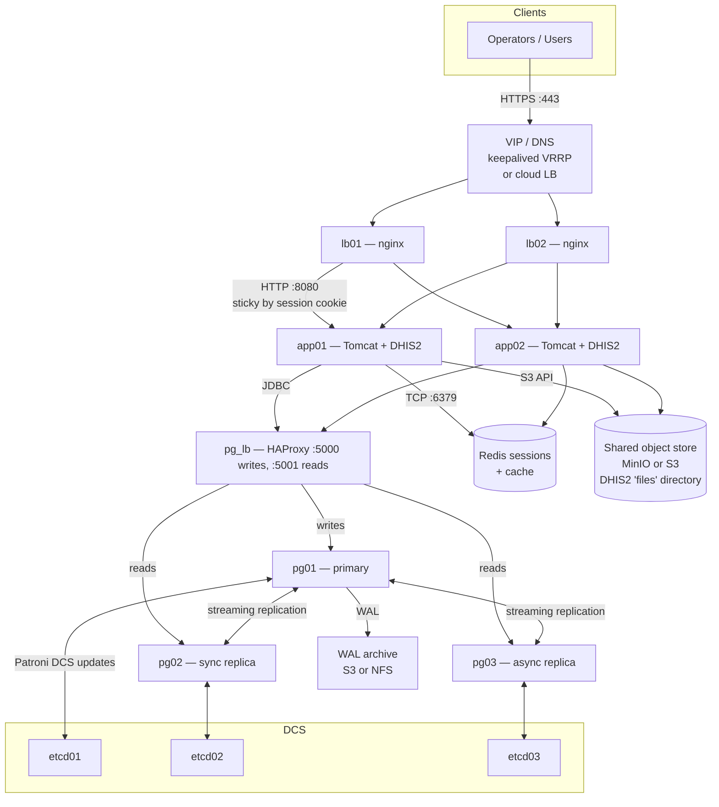

# DHIS2 Server Tools — HA deployment implementation plan

**Status:** draft plan (not yet implemented)
**Scope:** High-availability DHIS2 deployment with:
- active-active Tomcat application tier (shared session state)
- PostgreSQL primary + hot-standby replicas with automatic failover
- an L7 load balancer in front of Tomcat and an L4 router in front of
  PostgreSQL
- optional WAL archiving for point-in-time recovery
- rolling upgrades, zero-downtime for routine redeployments

**Explicitly out of scope (section 49 of the main requirements doc):**
- cross-region active-active (multi-primary PostgreSQL)
- Docker / Kubernetes orchestration
- a managed cloud-service wrapper (RDS, Cloud SQL)

**No-regression guarantee:** the single-node LXD, distributed-SSH, and
hybrid architectures continue to work unchanged. HA is strictly opt-in
via `dhis2_ha: true` and new inventory groups.

---

## 1. Goals and non-goals

### Goals

- Survive a single DB node failure with automatic promotion in under
  30 seconds and zero data loss (`synchronous_commit=on` for the
  committed-sync replica).
- Survive any single application-tier failure with no observable
  downtime (session continuity).
- Support rolling DHIS2 upgrades: upgrade one app node at a time while
  the other serves traffic.
- Keep the current operator surface identical. `dhis2-status`,
  `dhis2-deploy apply`, and `dhis2-upgrade run` behave the same;
  HA concerns are additive.
- Support regional deployments typical for DHIS2 implementations
  (3 to 7 hosts in one data centre or VPC, not globally distributed).

### Non-goals

- Geographic multi-region HA.
- RPO = 0 across unreliable WANs.
- Automatic healing of split-brain without operator action — detection
  and clean failure are in scope; opinionated automatic resolution is
  not.

---

## 2. Target architecture



### Minimum viable topology

- **2 app** nodes (Tomcat + DHIS2)
- **3 PG** nodes (Patroni-managed cluster: 1 primary, 1 sync replica, 1 async replica)
- **3 etcd** nodes (DCS quorum) — co-located with PG nodes to save
  hosts; dedicated nodes recommended for large deployments
- **1 pg_lb** node (HAProxy routing R/W to primary and R/O to
  replicas) — can be co-located with the app LB; two instances for LB
  HA via VRRP
- **2 LB** nodes (nginx) with keepalived VRRP for a floating VIP
- **1 Redis** node (or Sentinel cluster of 3) for shared Tomcat
  session store
- **S3-compatible object store** for `/opt/dhis2/files` (MinIO cluster,
  AWS S3, Hetzner Object Storage, …)
- **Monitoring + backup** host (unchanged from current single-node
  deployment)

**Total:** 8 hosts for a lean HA deployment that can co-locate PG and
etcd, down to 6 if the pg_lb is on the app LB nodes.

### Scaling expectations

| Dimension | Baseline (today) | HA baseline | Comment |
|-----------|------------------|-------------|---------|
| Concurrent sessions | 500 | 10k+ with sticky sessions on 2 app nodes | Redis moves the limit from JVM heap to Redis memory |
| Writes/sec | DB-CPU bound | Same primary throughput | Replication adds latency, not throughput |
| Read scaling | Not available | 2x–3x via replicas | Only for read-only queries routed by the app or pg_lb |
| Failure window | Minutes–hours | <30s DB; <10s app | With sync commit and keepalived priority |

---

## 3. Component choices

### 3.1 PostgreSQL HA: Patroni

**Decision:** Patroni on top of PostgreSQL streaming replication, backed by etcd.

**Why Patroni:**
- Industry-standard managed solution (Zalando, Spilo, Crunchy use it).
- Idempotent config via a single YAML (fits Ansible well).
- First-class REST API that HAProxy can call for health decisions —
  no stale state when leader moves.
- Explicit split-brain protection: Patroni never promotes a replica
  without DCS consensus.
- Streaming replication plus logical decoding gives us synchronous and
  cascading options.

**Rejected alternatives:**
- `repmgr`: simpler but no built-in DCS, failover is operator-triggered
  (we want automatic).
- `pg_auto_failover`: good but smaller operator community; monitor
  node is an extra single point of failure.
- Logical replication (`pglogical`, native pub/sub): wrong tool —
  schema-change coordination is painful for DHIS2 Flyway migrations.
- `pgpool-II`: operationally heavy; HAProxy + Patroni is lighter.
- Managed cloud (RDS/Aurora): out of scope; the project targets
  self-hosted.

**Replication tier:**
- 1 synchronous replica (`synchronous_commit=on`, `synchronous_standby_names=any 1 (...)`)
- 1 async replica for read scaling and warm standby
- `wal_level=replica`, `max_wal_senders=10`

### 3.2 DCS: etcd (3 nodes)

**Why etcd:**
- Patroni's reference DCS; most tested path.
- Simple Ansible playbook.
- No application dependencies.

**Rejected alternatives:**
- Consul: more features, more operational surface.
- ZooKeeper: JVM dependency; redundant with Tomcat already running JVMs.

### 3.3 Connection routing: HAProxy

**Role:** Routes writes to the Patroni leader on `:5000` and reads
to any up replica on `:5001`. HAProxy polls Patroni's REST API
(`/leader`, `/replica`) every 2 seconds. On a failover HAProxy
starts routing to the new leader within one health-check cycle.

**Decision:** Deploy HAProxy on the PG tier itself (pattern used by
Zalando) or as a dedicated pg_lb pair. We'll make it an inventory
decision (`[pg_lb]` group; falls back to co-located if the group is
empty).

**Not pgbouncer alone:** pgbouncer handles pooling but not
leader-election routing. We'll run **pgbouncer behind HAProxy** on the
app nodes to limit the number of real PG connections (DHIS2 opens many).

### 3.4 Tomcat session state: Redis

**Problem:** DHIS2's web UI relies on JSESSIONID. If the LB round-robins
across two Tomcats without sticky sessions, users get bounced and
sessions reset.

**Options considered:**

| Option | Pros | Cons |
|--------|------|------|
| Sticky sessions only | Simplest; no session store | Node failure logs users out; no even load distribution |
| Tomcat clustering (DeltaManager/BackupManager) | Standard, no external deps | Memory-heavy, requires multicast or static membership; brittle across LXD |
| Redis session store via `redisson-tomcat` or `tomcat-redis-session-manager` | Fast, operator-friendly, DHIS2 already integrates Redis for scheduler locks | Extra component to run (acceptable — we can share the DHIS2 Redis) |
| JDBC session store | No extra component | Adds load to the HA PostgreSQL cluster, which we're trying to protect |

**Decision:** **Sticky sessions in front (nginx `ip_hash` or
`consistent` with cookie-based affinity) PLUS Redis session store as
the fail-safe.** The sticky layer gives us cache locality; Redis gives
us failure continuity (a dead app node does not kill the session).

Use `tomcat-redis-session-manager` (Apache 2.0, maintained fork). We
ship the JAR via the `create-instance` role when `dhis2_ha=true`.

### 3.5 Shared file storage: S3-compatible

**Problem:** DHIS2 writes uploaded documents, custom-apps zip bundles,
and generated analytics files to `/opt/dhis2/files` (configurable via
`filestore.*` in `dhis.conf`). Two app nodes with separate local
`/opt/dhis2/files` directories WILL silently diverge.

**Decision:** Configure DHIS2's native filestore backend to point at an
S3-compatible endpoint. DHIS2 supports this out of the box.

```
filestore.provider = s3
filestore.container = dhis2-production-files
filestore.endpoint = https://minio.example.org
filestore.region = us-east-1
filestore.identity = <access-key>
filestore.secret = <secret>
```

For deployments that already have NFS/GlusterFS, we'll also support an
NFS-mount mode gated on `dhis2_ha_filestore: nfs`.

### 3.6 Load balancer: nginx + keepalived

**Keep nginx** — it's already in the stack and operators know it.
Add:
- `upstream` block listing both app nodes.
- `ip_hash` for session affinity (fallback to `sticky cookie` on
  OpenResty).
- `proxy_next_upstream` for automatic re-routing on 5xx.
- Health checks via `nginx-upstream-check` module (OpenResty bundles
  it) or the simpler `max_fails`/`fail_timeout`.

**keepalived** manages a floating VIP across the two LB nodes using
VRRP. In cloud environments, operators substitute the cloud LB (AWS
NLB, GCP ILB, Hetzner LB) and skip keepalived.

### 3.7 Backup and PITR: WAL-G or pgBackRest

**Current:** nightly `pg_dump` via the `backups` role.

**HA addition:** continuous WAL archiving to the same object store
used for DHIS2 files. On a bad migration or operator mistake, operators
can restore any point in time.

**Decision:** **WAL-G** — lightweight, S3-native, well-maintained,
small operational footprint. pgBackRest is more feature-rich but
heavier; we'll keep it as a future option.

The existing nightly logical backup remains the canonical
`dhis2-backup create` output; WAL archiving augments it.

---

## 4. New Ansible roles and inventory

### 4.1 New roles

```
deploy/roles/
  etcd/                 # install + bootstrap etcd quorum (3 nodes)
  patroni/              # install Patroni, template patroni.yml
  haproxy-pg/           # HAProxy for PG routing (REST-API-driven)
  keepalived/           # VRRP for the LB VIP
  tomcat-redis-session/ # ship the session-manager JAR + context.xml snippet
  redis/                # single-node Redis or Sentinel cluster
  wal-g/                # WAL archiving + base-backup helper
```

### 4.2 Existing roles — minimal changes

- `postgres`: when `dhis2_ha=true`, defer actual PG install to the
  `patroni` role; keep role variables so single-node continues to work.
- `create-instance`: template `dhis.conf` with `connection.url` pointing
  at the pg_lb virtual service (localhost:6432 if pgbouncer is
  co-located, else `pg-lb:5000`); add Redis session manager context
  when `dhis2_ha=true`.
- `proxy`: when `dhis2_ha=true`, render an `upstream` with every host
  in `[instances]`, enable sticky sessions, enable
  `proxy_next_upstream`.
- `backups`: keep nightly dump; add WAL-G timers when `dhis2_ha=true`.

### 4.3 Inventory shape

The current `hosts.template` gains groups that default to empty:

```ini
# single-node (today) - unchanged
[instances]
hmis  ansible_host=172.19.2.11  database_host=postgres

[databases]
postgres  ansible_host=172.19.2.20

[web]
proxy  ansible_host=172.19.2.2

[monitoring]
monitor  ansible_host=172.19.2.30

# -------- HA opt-in (dhis2_ha=true) --------
[pg_primary]
# pg01  ansible_host=10.0.1.21  patroni_name=pg01

[pg_replicas]
# pg02  ansible_host=10.0.1.22  patroni_name=pg02  patroni_sync_standby=true
# pg03  ansible_host=10.0.1.23  patroni_name=pg03

[etcd]
# etcd01  ansible_host=10.0.1.21
# etcd02  ansible_host=10.0.1.22
# etcd03  ansible_host=10.0.1.23

[pg_lb]
# haproxy_pg01  ansible_host=10.0.1.24

[lb]
# lb01  ansible_host=10.0.1.11  keepalived_priority=100
# lb02  ansible_host=10.0.1.12  keepalived_priority=90

[redis]
# redis01  ansible_host=10.0.1.31

[all:vars]
# dhis2_ha=true
# ha_vip=10.0.1.10
# ha_vip_interface=eth0
# ha_filestore=s3
# ha_wal_archive_url=s3://pg-wal-production
```

New role variables documented in `docs/HA-Variables.md`:

```
dhis2_ha: false                           # master opt-in
ha_cluster_name: dhis2                    # Patroni scope
ha_vip: 10.0.1.10                         # keepalived
ha_vip_interface: eth0
ha_filestore: s3 | nfs
ha_filestore_s3_bucket:
ha_filestore_s3_endpoint:
ha_pg_version: 16
ha_pg_sync_commit: on                     # strict mode
ha_pg_max_connections: 400
ha_pg_lb_write_port: 5000
ha_pg_lb_read_port: 5001
ha_tomcat_session_backend: redis | sticky
ha_redis_url:
ha_wal_archive_url:
ha_etcd_initial_cluster: pg01=https://10.0.1.21:2380,pg02=...
```

### 4.4 Dispatch

A new play-set `deploy/dhis2-ha.yml` is included from `deploy/dhis2.yml`
when `groups['pg_primary'] | length > 0`:

```yaml
- import_playbook: dhis2-ha.yml
  when: groups['pg_primary'] | default([]) | length > 0
```

`dhis2-ha.yml` runs the new HA roles in order:

```
etcd -> patroni -> wal-g -> haproxy-pg -> redis -> keepalived
```

Then the existing single-node plays run with HA-aware variables.

---

## 5. CLI additions and extensions

### 5.1 New top-level command: `dhis2-cluster`

```
dhis2-cluster status                              # cluster view - primary, replicas, lag, HAProxy backend state
dhis2-cluster leader                              # which node is primary right now
dhis2-cluster replicas                            # replica lag + sync vs async
dhis2-cluster lag                                 # streaming replication lag in bytes / seconds
dhis2-cluster failover [--to HOST] [--yes]        # manual failover (section 55 "safely")
dhis2-cluster switchover --to HOST [--yes]        # planned switchover (preserves consistency)
dhis2-cluster reinit REPLICA [--yes]              # rebuild a replica from the primary (pg_basebackup)
dhis2-cluster patroni-config [show|edit]          # view / edit Patroni DCS config via REST
dhis2-cluster etcd-health                         # DCS quorum check
dhis2-cluster vip                                 # which LB currently holds the VIP
dhis2-cluster watch                               # auto-refresh dashboard-style view
dhis2-cluster pause [--yes]                       # pause Patroni automatic failover (ops window)
dhis2-cluster resume [--yes]
```

All destructive operations (`failover`, `switchover`, `reinit`,
`pause`, `resume`) require explicit confirmation unless `--yes` is
supplied (section 33).

### 5.2 Extensions to existing commands

```
dhis2-status            # reports cluster state when dhis2_ha=true
dhis2-doctor cluster    # new sub-check: etcd quorum, Patroni state, replication lag, HAProxy backends
dhis2-db status         # when HA, shows per-node status via Patroni REST
dhis2-db connections    # per-node pg_stat_activity rollup
dhis2-db failover       # alias to dhis2-cluster failover
dhis2-backup create     # continues to work; nightly logical backup
dhis2-backup create --mode base --yes   # pg_basebackup + WAL base, for PITR seeding
dhis2-restore pitr --target '2026-10-29 14:00 UTC'   # new PITR restore
dhis2-upgrade run --all --serial 1 --rolling        # explicit rolling flag; one app node at a time
dhis2-proxy backend add HOST | remove HOST          # manage LB upstreams
dhis2-proxy drain HOST [--yes]                      # mark an app node out of rotation for maintenance
```

### 5.3 CLI contracts preserved

- All existing commands keep their exit codes and `--json` schema.
- `dhis2-status` adds a `cluster: {primary, replicas, lag_bytes}`
  section only when `dhis2_ha=true`; otherwise unchanged.

---

## 6. Operational runbooks (shipped as docs)

Each gets its own `docs/HA-Runbook-*.md`:

1. **HA-Runbook-Failover.md** — automatic vs manual, rollback.
2. **HA-Runbook-Rebuild-Replica.md** — pg_basebackup, pg_rewind,
   when to use each.
3. **HA-Runbook-Rolling-Upgrade.md** — DHIS2 upgrade with zero
   downtime: drain → upgrade → re-add → repeat.
4. **HA-Runbook-PITR.md** — restore to an exact timestamp from WAL.
5. **HA-Runbook-Split-Brain.md** — Patroni's safeguards; manual
   recovery when the DCS was lost.
6. **HA-Runbook-LB-Failover.md** — keepalived behaviour; cloud LB
   substitution.
7. **HA-Runbook-Capacity.md** — adding a third app node, adding a
   replica.
8. **HA-Runbook-Decommission.md** — scaling back from HA to single-node
   (yes, we need this; some deployments spike then shrink).

Each runbook explicitly lists failure modes, detection, decision, and
rollback steps.

---

## 7. Failure modes and automatic responses

| Failure | Detected by | Automatic response | Operator action |
|---------|-------------|---------------------|-----------------|
| App node crash | nginx health check | LB marks node down; traffic to the other | Investigate; `dhis2-instance restart` or re-provision |
| App node slow (not down) | nginx `max_fails` | LB opens circuit for `fail_timeout` | Investigate |
| PG primary crash | Patroni (DCS consensus) | Sync replica promoted; HAProxy repoints `:5000` | Verify data loss window; `dhis2-cluster reinit` on the dead node |
| Sync replica down | Patroni | Async replica may be promoted to sync | Investigate; may need manual sync election |
| All replicas down | Patroni | Primary refuses writes if `synchronous_commit=on` | Degraded mode: operator decides `pause` or `switch to async` |
| etcd minority partition | etcd quorum lost | Patroni enters read-only mode on all nodes | Restore quorum; `dhis2-cluster resume` |
| Redis down (sessions) | Tomcat session manager | Falls back to in-JVM session; users on the dead node log out | Restart Redis; sessions recreated on next login |
| S3 filestore down | DHIS2 app errors | 500s on document ops; UI remains partially functional | Investigate S3; DHIS2 retries |
| LB primary down | keepalived (VRRP) | VIP migrates to secondary within ~3s | Investigate; replace node |
| Both LBs down | — | Full outage | Replace LBs; `keepalived` auto-recovers |

Patroni's split-brain protection: a replica WILL NOT promote without
DCS consensus. If the primary is isolated but still alive, it
demotes itself. Operators must restore DCS quorum before any writes
resume.

---

## 8. Testing strategy

### 8.1 Molecule scenarios (CI, Docker-based)

- `molecule/ha-patroni-bootstrap` — 3 PG nodes + 3 etcd nodes come up,
  Patroni elects a leader, HAProxy routes correctly.
- `molecule/ha-failover` — kill the primary container, assert a
  replica is promoted in <30s and HAProxy repoints.
- `molecule/ha-app-rolling-upgrade` — 2 app containers, upgrade one
  while traffic hits the other, no 5xx observed.
- `molecule/ha-session-continuity` — login on app01, kill app01,
  session must survive on app02 (via Redis).

### 8.2 Vagrant / full-stack test (local operator smoke test)

- `tests/ha/Vagrantfile` provisions 8 LXD VMs on the operator's
  workstation with Vagrant + libvirt or Vagrant + VirtualBox.
- `tests/ha/run.sh` runs the full dhis2-ha.yml, kills random nodes in a
  chaos loop, and asserts dhis2-status --json reports healthy at the
  end of each cycle.

### 8.3 Regression

- Every existing scenario A–AV must still pass with `dhis2_ha=false`
  (default).
- New scenarios BA–BM cover HA-specific invariants (failover under
  write load, Redis session survival, HAProxy backend swap under app
  restart, VIP migration, WAL archive integrity).

### 8.4 Chaos engineering

- `dhis2-cluster chaos [--target primary|replica|lb|redis|etcd]
  --duration 60s`: kills the component, waits, restores. Intended for
  smoke-testing new deployments. Opt-in; refuses to run with
  `DHIS2_ENVIRONMENT=production`.

---

## 9. Migration path from single-node

The operator starts with the current single-node deployment. HA
migration follows:

1. **Capacity + backup**: full `dhis2-backup create --mode base`
   (new) plus logical backup; confirm WAL archive destination exists.
2. **Provision new hosts** (2 app, 2 replica DB, 3 etcd minimum).
3. **Bring up etcd** (`ansible-playbook dhis2-ha.yml --tags etcd`).
4. **Convert the existing PG to Patroni** (`--tags patroni`): the
   existing data directory becomes the Patroni leader without a
   pg_basebackup; replicas are seeded via pg_basebackup. The role
   templates `patroni.yml` and renames the existing postgresql service
   to Patroni-managed.
5. **Point apps at the new pg-lb** by templating `dhis.conf` with the
   HA endpoint — the role does this when `dhis2_ha=true`.
6. **Add the second app node** and the LB pair.
7. **Switch DNS / VIP** to the new LB.
8. **Smoke test** with `dhis2-cluster status`, `dhis2-doctor cluster`,
   `dhis2-cluster failover`.

Steps 4–5 can be done with ~2 minutes of writes paused via
`dhis2-proxy drain all` + application restart. Step 6 onward is
zero-downtime for existing users.

**Rollback path:** promote the former single-node PG back to standalone
by running `patronictl remove`, re-point `dhis.conf`, restart Tomcat.
Documented in `docs/HA-Runbook-Decommission.md`.

---

## 10. Monitoring additions

Extend the `monitoring` role (section 21) to collect:

- **Patroni REST API** → scrape `/metrics` (Patroni 3+ exposes
  Prometheus metrics natively). Dashboards for cluster state,
  current leader, replication lag, DCS access errors.
- **HAProxy** stats socket → Prometheus `haproxy_exporter`.
- **etcd** `/metrics` endpoint.
- **Redis** → `redis_exporter`.
- **WAL-G** → scrape backup success timestamp from the state file.

New Grafana dashboards shipped under
`deploy/roles/monitoring/files/dashboards-ha.json`.

New alerts (shipped by the `alerting` role when `dhis2_ha=true`):

- Primary absent for >30s
- Replication lag > 5 min on any replica
- etcd quorum lost
- Any HAProxy backend down for >60s
- WAL archive success timestamp older than 15 min
- Redis unreachable from any app node
- VIP master unknown

---

## 11. Backup, DR, and PITR

- **Logical backup** (`pg_dump --format=custom`): keeps its current
  role as the human-friendly recovery artefact. Nightly.
- **Base backup** (`pg_basebackup --format=tar --wal-method=stream`):
  weekly. Seeds PITR.
- **WAL archive** (via WAL-G): continuous. Stored in the same object
  store as DHIS2 filestore.
- **PITR restore** (`dhis2-restore pitr --target TIMESTAMP`):
  provisions a new PG host (or an isolated clone), replays WAL to the
  target, promotes.
- **Backup lifecycle**: WAL-G retention and prune are handled by WAL-G
  itself; the `dhis2-backup prune` command keeps logical backup
  retention as today.

---

## 12. Security additions

- **mTLS everywhere between PG nodes** — Patroni + libpq support it
  natively; role templates server/client certs via the project's
  existing TLS variables.
- **etcd peer and client TLS**.
- **Redis AUTH** + optionally Redis TLS.
- **HAProxy stats socket** on a Unix socket, not TCP.
- **S3 credentials** via the vault; `dhis2-security audit` already
  warns on world-readable credential files.
- **Firewall posture** — new `dhis2-security harden` rules close PG
  replication ports (`5432`, `5433`) to anything but the cluster
  members. Codified in the `pre-install` role.
- **New section in `dhis2-doctor cluster`** cross-checks that:
  - all cluster members use mTLS,
  - the Patroni REST API is bound to a non-public address,
  - the etcd client cert matches,
  - WAL archive bucket is not world-readable.

---

## 13. Phased delivery

### Phase 0 — Design and ADR (1 week)

- Open RFC in the repo (`docs/vital-enhancements/ha-adr.md`) covering
  the decisions in sections 3 and 4.
- Reach consensus with upstream before writing a role.
- Freeze the inventory shape in section 4.3.

### Phase 1 — Patroni + etcd + HAProxy on an existing single node (2–3 weeks)

- `etcd`, `patroni`, `haproxy-pg` roles.
- Convert `postgres` role to delegate when `dhis2_ha=true`.
- Molecule scenario: 3-node PG cluster boots, elects, fails over.
- CLI: `dhis2-cluster status | leader | replicas | lag | failover |
  switchover | reinit`.
- Doc: `docs/HA-Patroni.md`, `docs/HA-Runbook-Failover.md`.

**Deliverable:** operator can run a 3-node PG HA cluster behind a
single-node app. No app-tier HA yet.

### Phase 2 — App-tier HA + session store + LB (2 weeks)

- `redis`, `tomcat-redis-session`, `keepalived` roles.
- Extend `proxy` role for sticky sessions, `proxy_next_upstream`,
  `upstream` with multiple backends.
- `create-instance` role teaches `dhis.conf` about the HA PG endpoint,
  Redis session backend, and the S3 filestore.
- CLI: `dhis2-proxy backend add | remove | drain`, `dhis2-cluster vip`.
- Doc: `docs/HA-Runbook-Rolling-Upgrade.md`, `docs/HA-Runbook-LB-Failover.md`.

**Deliverable:** multi-app, multi-DB cluster with a floating VIP.
Rolling DHIS2 upgrade works.

### Phase 3 — WAL archiving and PITR (1 week)

- `wal-g` role.
- `dhis2-backup create --mode base`, `dhis2-restore pitr`.
- Doc: `docs/HA-Runbook-PITR.md`.

**Deliverable:** continuous WAL archive, PITR restore proven.

### Phase 4 — Monitoring, alerting, hardening (1–2 weeks)

- Grafana dashboards for Patroni / HAProxy / etcd / Redis.
- New alert rules.
- `dhis2-doctor cluster` cross-check.
- `dhis2-security` HA checks.
- Chaos smoke-test script.

**Deliverable:** production-ready observability and security
hardening.

### Phase 5 — Migration tooling and docs (1 week)

- `dhis2-cluster migrate-from-single-node` guided wizard.
- `docs/HA-Migration-From-Single-Node.md`.
- Updated README with HA diagram and quickstart.

### Phase 6 — Hardening sprint

- Chaos engineering runs on a real multi-host environment.
- Load tests at expected production scale.
- Doc QA pass.
- Upstream pull request.

**Total realistic timeline:** 8–10 weeks for one engineer, 4–6 weeks
for two working in parallel.

---

## 14. Decisions (locked)

The following were decided during the plan review. Each becomes a
one-paragraph ADR under `docs/vital-enhancements/ha-adr-NN.md` during
Phase 0.

| # | Decision | Consequence |
|---|----------|-------------|
| 1 | **Minimum DHIS2 baseline for HA: 2.41+** | Both Tomcat 9 (2.41) and Tomcat 10 (2.42+) are in scope. We ship two Redis session-manager JARs (`tomcat-redis-session-manager` for Tomcat 9 and the `redisson-tomcat-10` build for Jakarta namespaces) and select the correct one via `tomcat_version`. |
| 2 | **Minimum PostgreSQL major: 16 only** | Patroni config, HAProxy integration tests, and WAL-G flags are specialised for one PG major. Operators on PG 15 or older must upgrade PG before adopting HA. |
| 3 | **etcd deployment: dedicated `[etcd]` inventory group required** | Minimum 6 hosts for a lean HA deployment (3 PG + 3 etcd). Clean failure isolation: DCS loss does not take PG down with it. Matches enterprise best practice. The role refuses to start if `[etcd]` is empty when `dhis2_ha=true`. |
| 4 | **LB failover mechanism: documented both, prompt at init** | `dhis2-deploy init --architecture ha` prompts the operator to choose `keepalived` (L2 VIP) or `dns-rr` (route-level). Role templates both; the `ha_lb_mode` inventory variable selects the active one. Defaults to `keepalived` when unset. |
| 5 | **MinIO shipped as a role** | New `minio` role with two modes: `single-node` (dev / small production) and `distributed-4` (production minimum for erasure coding). We own the operational support for a small MinIO deployment; operators who already run S3 or an external MinIO set `ha_filestore_external=true` and skip the role. |
| 6 | **Inventory shape: keep `[databases]`, add host var `ha_role=primary|replica`** | Backward compatible. Existing single-node operators who adopt HA add replica hosts to `[databases]` and set `ha_role` per host. The migration path from single-node needs no inventory restructure. Sync-standby selection is a second host var `ha_pg_sync_standby=true` (at most one host). |
| 7 | **WAL archive and DHIS2 filestore: two buckets, two credentials** | Blast-radius isolation. A compromised DHIS2 upload-credential cannot damage the WAL archive (which is needed for PITR). Role variables: `ha_filestore_bucket`/`ha_filestore_credentials` and `ha_wal_bucket`/`ha_wal_credentials`. Operators who insist on one bucket can set `ha_wal_credentials=ha_filestore_credentials` and point to a WAL prefix. |
| 8 | **DHIS2 upgrade + Patroni coordination: auto-pause by default, `--no-auto-pause` to disable** | `dhis2-upgrade run --rolling` calls `dhis2-cluster pause` before the first app-node upgrade and `dhis2-cluster resume` after the last. Prevents Patroni from issuing a failover mid-upgrade. Operators who want to coordinate manually pass `--no-auto-pause`; the command then refuses to proceed unless Patroni is already paused (section 33 safety). |

### Updated role list (reflecting decisions)

```
deploy/roles/
  etcd/                 # dedicated [etcd] group, 3 nodes minimum
  patroni/              # PG 16 only; patroni.yml templated per decision 6
  haproxy-pg/           # routes writes/reads per Patroni REST state
  keepalived/           # when ha_lb_mode=keepalived
  dns-rr/               # when ha_lb_mode=dns-rr (templates a health-check script that updates DNS records via a configurable provider plugin)
  tomcat-redis-session/ # selects JAR by tomcat_version (9 or 10)
  redis/                # single-node Redis or Sentinel cluster
  minio/                # NEW: single-node or distributed-4
  wal-g/                # separate bucket + credentials
```

### Updated inventory shape (reflecting decisions)

```ini
# single-node (today) - unchanged
[instances]
hmis  ansible_host=172.19.2.11  database_host=postgres

# HA opt-in - keep [databases], mark primary/replica per host
[databases]
pg01  ansible_host=10.0.1.21  ha_role=primary
pg02  ansible_host=10.0.1.22  ha_role=replica  ha_pg_sync_standby=true
pg03  ansible_host=10.0.1.23  ha_role=replica

[etcd]
etcd01  ansible_host=10.0.1.31
etcd02  ansible_host=10.0.1.32
etcd03  ansible_host=10.0.1.33

[pg_lb]
# optional - co-locates with [lb] if empty

[lb]
lb01  ansible_host=10.0.1.11  keepalived_priority=100
lb02  ansible_host=10.0.1.12  keepalived_priority=90

[redis]
redis01  ansible_host=10.0.1.41

[minio]
minio01  ansible_host=10.0.1.51
# add 3 more for distributed-4 mode

[all:vars]
dhis2_ha=true
ha_lb_mode=keepalived              # or dns-rr
ha_vip=10.0.1.10                   # keepalived only
ha_vip_interface=eth0              # keepalived only
ha_dns_provider=                   # dns-rr only (route53, cloudflare, ...)

ha_filestore_bucket=dhis2-files-production
ha_filestore_endpoint=https://minio01:9000
ha_filestore_credentials=/opt/ansible/secrets/filestore_credentials

ha_wal_bucket=dhis2-wal-production
ha_wal_endpoint=https://minio01:9000
ha_wal_credentials=/opt/ansible/secrets/wal_credentials

ha_minio_mode=single-node          # or distributed-4; absent when ha_filestore_external=true
ha_filestore_external=false        # true to skip the minio role
```

### CLI additions (reflecting decisions)

```
dhis2-cluster pause [--yes]                              # Patroni DCS pause
dhis2-cluster resume [--yes]
dhis2-upgrade run --all --rolling                        # auto-pauses Patroni; auto-resumes
dhis2-upgrade run --all --rolling --no-auto-pause        # fails unless Patroni already paused
dhis2-deploy init --architecture ha                      # prompts for ha_lb_mode
```

---

## 15. Acceptance criteria (summary)

Before this HA work can land upstream:

### Functional

- [ ] 3-node Patroni cluster bootstraps from scratch (Molecule).
- [ ] Automatic failover under primary-kill in <30s (Molecule).
- [ ] HAProxy repoints writes to the new leader within 1 health-check
      cycle.
- [ ] 2-node Tomcat with Redis sessions survives app-kill with session
      continuity (Molecule).
- [ ] Floating VIP migrates between LBs in <5s (local test).
- [ ] WAL archiving produces a usable archive and PITR restore
      round-trips.
- [ ] Rolling DHIS2 upgrade across 2 app nodes with zero 5xx observed
      from the client side.
- [ ] All existing single-node scenarios A–AV still pass with
      `dhis2_ha=false`.

### Safety

- [ ] Split-brain protection verified (Patroni refuses to promote
      without DCS).
- [ ] Operator cannot accidentally promote a replica without
      confirmation.
- [ ] mTLS between all cluster members validated.
- [ ] No HA secret appears in process listings or logs.
- [ ] All destructive HA operations require `--yes`.

### Compatibility

- [ ] Existing `deploy.sh` continues to work for single-node
      deployments.
- [ ] Operators who do NOT set `dhis2_ha=true` see no behavioural
      change.
- [ ] The regression report shows `pass/pass` for every existing row.

### Documentation

- [ ] docs/HA.md top-level entry point.
- [ ] One runbook per failure mode.
- [ ] Migration guide from single-node.
- [ ] Updated README diagrams.

---

## 16. What we are explicitly NOT doing

- Multi-primary / BDR replication.
- Cross-region active-active.
- Automatic re-provisioning from clouds (we remain host-agnostic).
- Kubernetes operators (section 49 defers).
- Changing DHIS2's own clustering story upstream — we work with
  whatever DHIS2 ships.
- Pretending Patroni's `synchronous_commit=on` + 1 sync replica is
  zero-data-loss across datacentres; it is zero-data-loss within one
  AZ-equivalent.

---

## 17. Risk register

| Risk | Likelihood | Impact | Mitigation |
|------|------------|--------|------------|
| DHIS2 Flyway migrations incompatible with sync replica lag | Medium | High | Pause writes during migration via `dhis2-cluster pause`; `dhis2-upgrade run --rolling` triggers automatically |
| Redis becomes a new single point of failure | High if single-node Redis | Medium | Default to Redis Sentinel (3 nodes); documented in Phase 2 |
| etcd disk full → DCS lockup | Medium | High | Monitor etcd disk via existing monitoring role; alert at 80% |
| HAProxy misconfig takes down writes | Medium | High | `dhis2-proxy test` already validates nginx; add equivalent for HAProxy |
| S3 outage disables document uploads | Medium | Medium | DHIS2 UI continues to work for non-document operations; alert on S3 error rate |
| Operator mistakes `--to HOST` in a failover | Low | High | Confirmation + typing the host name required (section 33) |
| Rolling upgrade reveals a DHIS2 bug only visible in HA | Medium | Medium | Phase 6 chaos testing; staged rollout |
| Patroni version drift across cluster | Low | High | `dhis2-cluster status` reports and warns |

---

## Appendix A — Reference `patroni.yml` (abridged)

```yaml
scope: {{ ha_cluster_name }}
name: {{ patroni_name }}

restapi:
  listen: {{ ansible_default_ipv4.address }}:8008
  connect_address: {{ ansible_default_ipv4.address }}:8008
  authentication:
    username: {{ patroni_rest_user }}
    password: "{{ patroni_rest_password }}"

etcd3:
  hosts: {{ groups['etcd'] | map('extract', hostvars, 'ansible_default_ipv4') | map(attribute='address') | map('regex_replace', '^(.*)$', '\\1:2379') | join(',') }}
  protocol: https

bootstrap:
  dcs:
    ttl: 30
    loop_wait: 10
    retry_timeout: 10
    maximum_lag_on_failover: 1048576
    synchronous_mode: true
    synchronous_mode_strict: false
    postgresql:
      use_pg_rewind: true
      parameters:
        max_connections: {{ ha_pg_max_connections }}
        shared_buffers: {{ pg_shared_buffers | default('4GB') }}
        wal_level: replica
        hot_standby: 'on'
        max_wal_senders: 10
        max_replication_slots: 10
        synchronous_commit: {{ ha_pg_sync_commit }}
        synchronous_standby_names: 'ANY 1 ({{ groups["pg_replicas"] | select("match", ".*sync.*") | map(attribute="patroni_name") | join(",") }})'
        archive_mode: 'on'
        archive_command: 'wal-g wal-push %p'
```

## Appendix B — Reference HAProxy config for PG routing (abridged)

```
listen postgres-write
    bind *:5000
    option httpchk GET /leader
    http-check expect status 200
    default-server inter 2s fall 3 rise 2 on-marked-down shutdown-sessions
    server pg01 10.0.1.21:5432 check port 8008
    server pg02 10.0.1.22:5432 check port 8008
    server pg03 10.0.1.23:5432 check port 8008

listen postgres-read
    bind *:5001
    balance leastconn
    option httpchk GET /replica
    http-check expect status 200
    default-server inter 2s fall 3 rise 2
    server pg01 10.0.1.21:5432 check port 8008
    server pg02 10.0.1.22:5432 check port 8008
    server pg03 10.0.1.23:5432 check port 8008
```

Writes always go to the Patroni leader (returned by `/leader`). Reads
load-balance across every node that returns `/replica` (including the
primary when there are no replicas up).

## Appendix C — Operator onboarding (one-command experience, target)

Once Phase 2 lands:

```bash
dhis2-deploy init --architecture ha
# edits deploy/inventory/hosts.ha

vim deploy/inventory/hosts.ha

dhis2-deploy preflight       # new HA preflight: etcd quorum, VIP reachability, S3 reachability
dhis2-deploy plan
dhis2-deploy apply

dhis2-cluster status
dhis2-doctor cluster
```

If this experience is not possible to achieve, we have failed on the
operator ergonomics side and should iterate the design.
